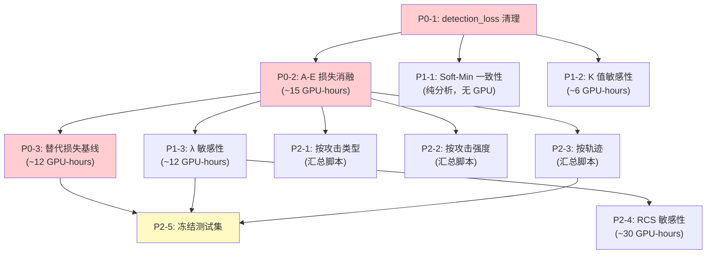

# 正式实验设计方案

> 生成日期：2026-07-24
> 基于：KAA 与 BCE 均从随机初始化开始训练（`initial_checkpoint=null`）
> 所有实验使用无邻域 8 维特征（`RESIDUAL_FEATURE_NAMES + SELF_FEATURE_NAMES`）

---

## 实验全景

```
P0: 阻塞性（投稿前必须完成）
├── P0-1: 代码一致性清理（detection_loss 移除）
├── P0-2: 损失消融（A/B/C/D/E 五组）
└── P0-3: 替代损失基线（onset-weighted BCE / Focal Loss）

P1: 方法验证（支撑算法创新）
├── P1-1: Soft-Min 与硬 K 步一致性
├── P1-2: K 值敏感性
└── P1-3: 事件损失超参数敏感性

P2: 系统验证（支撑泛化与说服力）
├── P2-1: 按攻击类型分层
├── P2-2: 按攻击强度分层
├── P2-3: 多轨迹按轨迹分层
├── P2-4: RCS/有效回波强度敏感性
└── P2-5: 生成冻结最终测试集

P3: 可选扩展（不阻塞主线）
├── P3-1: 长时间多攻击场景
├── P3-2: 图注意力邻机编码
└── P3-3: IMU 特征融合
```

---

## P0-1：代码一致性清理

| 项目 | 内容 |
|---|---|
| **目标** | 移除未使用的 `detection_loss`，统一代码/测试/配置/日志/论文公式 |
| **当前状态** | `training.py` 第 560 行已注释 `detection_loss_weight * detection_loss`，但变量仍在计算、打印、保存 |
| **操作** | (1) 从损失计算中删除 `detection_loss` 变量；(2) 从 `TrainingConfig` 移除 `detection_loss_weight` 字段；(3) 更新所有单元测试；(4) 更新 `current_loss_design.md`；(5) 检查所有旧 JSON 配置 |
| **成功标准** | `grep -r "detection_loss" src/` 仅匹配测试中故意的旧格式兼容测试 |
| **类型** | 代码清理 |

---

## P0-2：损失组成消融（核心公平性实验）

**关键事实**：BCE 和 KAA 都从零开始训练，使用相同的 `max_epochs`、`patience`、`lr`。KAA 的 `event_ramp_epochs=0`，事件损失从 epoch 1 生效。

| 组别 | `loss_objective` | `delay_loss_weight` | `false_alarm_loss_weight` | 说明 |
|---|---|---|---|---|
| **A** | `bce` | — | — | 纯 BCE 基准（已有 3 seeds） |
| **B** | `bce` | — | — | 从 A 的 best checkpoint 继续 BCE 训练（同 lr/patience） |
| **C** | `event_likelihood` | 0.01 | 0.0 | BCE + 仅早检正则 |
| **D** | `event_likelihood` | 0.0 | 0.5 | BCE + 仅误报正则 |
| **E** | `event_likelihood` | 0.01 | 0.5 | BCE + 完整 KAA（已有 3 seeds） |

| 项目 | 内容 |
|---|---|
| **数据** | `d1_5000_complete_seed20260716_new_attack_fast_half_target_f11` |
| **特征** | 8 维无邻域（`RESIDUAL_FEATURE_NAMES + SELF_FEATURE_NAMES`） |
| **模型** | GRU, hidden_dim=64, num_layers=1 |
| **随机种子** | 20260718, 20260719, 20260720（每个 seed 独立训练） |
| **checkpoint 选择** | 验证集最小总损失 |
| **B 组 checkpoint** | 复用 A 组对应 seed 的 `best_model.pt` |

**各组回答的问题**：

| 对比 | 问题 |
|---|---|
| B vs. A | BCE 是否训练不充分？额外训练能否追平 KAA？ |
| C vs. A | 早检正则独立贡献了什么？ |
| D vs. A | 误报正则独立贡献了什么？ |
| E vs. D | 加入早检项是否有额外增益？ |
| E vs. C | 加入误报项是否有额外增益？ |
| E vs. B | KAA 增益是否来自损失设计而非训练时长？ |

**预期**：
- B ≈ A（BCE 已收敛，多训无益）
- D > A（误报正则降低 FAR，提高 Precision）
- C 不改善延迟（与历史一致），但不应损害 FAR
- E ≥ max(C, D)，两项互补

**报告指标**（所有组 × 所有 seed）：
- Event Precision / Recall / F1
- False Alarms per UAV·hour
- Clean episode alarm probability
- 平均/中位检测延迟
- DR@0.5 / 1 / 2 / 5 s
- Bootstrap 95% CI

---

## P0-3：替代损失基线

| 组别 | 训练配置 | 说明 |
|---|---|---|
| **A** | 纯 BCE | 基准（复用 P0-2-A） |
| **F** | Onset-weighted BCE | 攻击起始附近 step 赋予更高 BCE 权重 |
| **G** | Focal Loss (γ=2) | 聚焦难分类样本 |
| **E** | KAA 完整 | 本文方法（复用 P0-2-E） |

| 项目 | 内容 |
|---|---|
| **目标** | 证明 KAA 优于更简单的损失修正方案 |
| **数据/模型/种子** | 同 P0-2 |
| **关键对比** | E vs. F, E vs. G 的成对 Event F1 和 FAR 差值 + bootstrap CI |

**Onset-weighted BCE 实现思路**：
- 攻击事件的前 H 秒（如 H=3s）内的 step 赋予权重 w>1
- 或使用指数衰减权重：攻击开始后权重随 step 递减

**预期**：KAA 在 Precision/F1/FAR 上优于 F 和 G，因为 KAA 直接建模事件报警行为而非仅仅是 step 级困难度。

---

## P1-1：Soft-Min 与硬 K 步一致性

| 项目 | 内容 |
|---|---|
| **目标** | 量化软确认 hazard 与硬 K 步报警规则在验证集上的偏差 |
| **方法** | 加载已训练 KAA 模型的 logits，分别计算软/硬 K 步确认，逐 step 比较 |
| **扫描温度** | `T ∈ {1.0, 0.5, 0.2, 0.1, 0.05}` |
| **报告** | (1) 软/硬决策不一致率；(2) Soft-Min 与硬最小值的 MAE/RMSE；(3) 梯度范数统计；(4) NaN/Inf 比例 |

| 温度 T | 预期不一致率 | 说明 |
|---|---|---|
| 1.0 | ~5-10% | 过度平滑 |
| 0.5 | ~2-5% | 仍偏软 |
| 0.2 | ~1-2% | 接近硬规则 |
| **0.1** | **<1%** | **当前设置，预期最优** |
| 0.05 | <1% | 可能梯度不稳定 |

**成功标准**：T=0.1 不一致率 < 1%，无 NaN/Inf，梯度范数稳定。

---

## P1-2：K 值敏感性

| 项目 | 内容 |
|---|---|
| **扫描** | `K ∈ {1, 3, 5, 7, 10}` |
| **注意** | K=1 退化为逐 step 报警，应与 BCE 表现接近 |
| **训练** | 每个 K 值独立训练 1 个 seed（可用 20260718） |
| **报告** | 每种 K 的 Event Precision/Recall/F1/FAR/延迟分布 |

**预期曲线**：

```
     Precision ──→ 单调上升（K 越大要求越严格）
     Recall    ──→ 单调下降（K 越大越难触发报警）
     FAR       ──→ 单调下降
     Delay     ──→ 单调上升
     F1        ──→ 倒 U 型，K=5 附近峰值
```

---

## P1-3：事件损失权重敏感性

| 项目 | 内容 |
|---|---|
| **策略** | 两步扫描：(1) 固定 λ_f=0.5，扫 λ_d；(2) 固定最优 λ_d，扫 λ_f |
| **λ_d 扫描** | `{0.001, 0.005, 0.01, 0.02, 0.05}` |
| **λ_f 扫描** | `{0.1, 0.2, 0.5, 1.0, 2.0}` |
| **训练** | 每组 1 seed（20260718） |
| **报告** | Precision-Recall-FAR-Delay 平行坐标图或热力图 |

**预期**：存在 Pareto 前沿；当前 (0.01, 0.5) 在合理范围内。

---

## P2-1：按攻击类型分层

| 项目 | 内容 |
|---|---|
| **数据** | 复用 P0-2 中 A 和 E 的 3 seed 测试集预测 |
| **分组** | clean / random / replay / stealth |
| **报告** | 表格：4 攻击类型 × 2 方法 × event 指标（均值±std） |

**预期**：stealth 最差（所有方法），KAA 在 stealth 上的 FAR 改善可能最大。

---

## P2-2：按攻击强度分层

| 项目 | 内容 |
|---|---|
| **分组** | weak / medium / strong |
| **报告** | 表格：3 强度 × 2 方法 × event 指标 |

**预期**：weak 攻击最难检测（低 SNR），KAA 相对增益在 weak 上更大。

---

## P2-3：多轨迹按轨迹分层

| 项目 | 内容 |
|---|---|
| **数据** | `d1_1600_multitrajectory_test_rcs12_seed20260723` |
| **已有** | 总体多轨迹结果（BCE 和 KAA 各 3 seeds） |
| **需要做** | 按 straight / circle / helix / s_curve 分别汇总 |
| **报告** | 表格：4 轨迹 × 2 方法 × 指标；seen (s_curve) vs. unseen (straight/circle/helix) 聚合 |

---

## P2-4：RCS / 有效回波强度敏感性

| 项目 | 内容 |
|---|---|
| **目标** | 证明方法在不同 ISAC 测量质量下均有效，非单一 SNR 特例 |
| **扫描** | RCS ∈ {2, 4, 6, 8, 12, 16, 24} |
| **注意** | 每个 RCS 需要独立生成训练+测试数据（或从现有数据降采样 SNR 模拟） |
| **训练** | 每个 RCS × 1 seed × BCE + KAA |
| **报告** | 性能 ~ RCS 曲线，标注性能可接受的最低 RCS |

**选项 B（低成本）**：直接在现有 RCS=12 的数据上对 ISAC 测量加不同强度的噪声，模拟更低 SNR。

---

## P2-5：冻结最终测试集

| 项目 | 内容 |
|---|---|
| **时机** | P0 和 P1 全部完成，方案锁定后 |
| **规格** | ≥1000 episodes，straight/circle/helix/s_curve × clean/random/replay/stealth 均衡 |
| **约束** | (1) 全新随机种子；(2) 生成后绝不用于模型选择或超参调优；(3) 只在投稿前跑一次最终评价 |
| **RCS** | 12（与训练数据一致） |

---

## 实验执行顺序



---

## 总 GPU 时间估算

| 优先级 | 实验 | 估算 GPU-hours |
|---|---|---|
| P0 | 代码清理 + 损失消融 + 替代基线 | ~27 |
| P1 | 一致性分析 + K/λ 敏感性 | ~18 |
| P2 | 分层汇总 + RCS + 冻结测试 | ~30 |
| **P0+P1+P2 合计** | | **~75** |
| P3 | 可选扩展 | ~40+ |

---

## 与已有实验的关系

| 已有实验 | 可复用为 |
|---|---|
| `feature_ablation_gru_rcs12__5sets_formal` / `no_neighbor` (3 seeds) | P0-2 组 A（纯 BCE 基准） |
| `neighbor_signed_vs_none_event_likelihood_scratch` / `no_neighbor` (3 seeds) | P0-2 组 E（完整 KAA） |
| `multitrajectory_test_bce_no_neighbor` | P2-3 BCE 列 |
| `multitrajectory_test_event_likelihood_no_neighbor` | P2-3 KAA 列 |

---

## 论文中如何呈现实验

建议的实验章节结构：

```
V. Experiments
  A. Experimental Setup（数据/特征/模型/训练/评价协议）
  B. Comparison with Baselines（P0-2 A vs. E 主结果 + P0-3 F/G 对比）
  C. Loss Ablation Study（P0-2 五组 + P1-3 敏感性）
  D. Alarm Parameter Analysis（P1-1 Soft-Min 一致性 + P1-2 K 敏感性）
  E. Generalization Analysis（P2-1 攻击类型 + P2-2 攻击强度 + P2-3 多轨迹）
  F. ISAC Measurement Quality Sensitivity（P2-4 RCS 敏感性）
```

全部实验使用 8 维无邻域特征 + GRU(hidden_dim=64, num_layers=1)。K=5, T=0.1。
